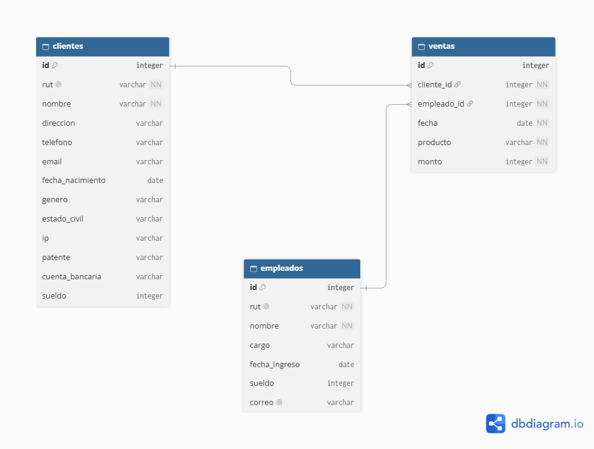

# auditor-ley-21719

Auditor de datos personales según la Ley 21.719 (Chile), con datos ficticios.

Proyecto personal que detecta datos personales en las bases de una pyme ficticia, mide su calidad y duplicados, los clasifica con IA y muestra los resultados en un dashboard.

> Aviso: todos los datos de este repositorio son ficticios, generados con Faker. No hay datos reales de personas.

## Qué hace el proyecto hasta ahora

- **Genera los datos de una pyme ficticia** con Faker: 100 clientes, 50 empleados y 300 ventas, siempre los mismos gracias a una semilla fija.
- **Valida RUT chilenos** con el algoritmo módulo 11, con pruebas automáticas en pytest.
- **Define un modelo de datos** con claves primarias y foráneas (`schema.sql`), donde cada venta pertenece a un cliente y fue hecha por un empleado.
- **Crea una base SQLite** (`pyme_modelo.db`) a partir de ese modelo, en la que la propia base impide registrar ventas con clientes o empleados inexistentes.
- **Responde 11 preguntas con SQL** (`consultas.sql`): cruces entre tablas con JOIN, búsqueda de clientes y empleados sin ventas, y resúmenes con GROUP BY como ventas por producto, por mes y rankings.
- **Planta errores a propósito** para que el auditor tenga algo que detectar: RUT inválidos, ventas huérfanas y empleados sin ventas.

## Tecnologías

- Python (pandas, Faker, pytest)
- SQL (SQLite)
- Power BI (próximamente)

## Estructura del repositorio

| Archivo | Descripción |
|---|---|
| rut.py | Funciones para calcular, validar y generar RUT con el algoritmo módulo 11 |
| test_rut.py | Pruebas automáticas de `validar_rut` con pytest |
| generar_clientes.py | Genera 100 clientes ficticios (con 5 RUT inválidos a propósito) |
| generar_empleados.py | Genera 50 empleados ficticios con RUT válido y correo corporativo |
| schema.sql | Modelo de datos con CREATE TABLE, claves primarias y foráneas |
| probar_schema.py | Prueba que `schema.sql` crea las tablas y que las FK bloquean ventas huérfanas |
| crear_modelo.py | Crea `pyme_modelo.db` desde `schema.sql`, carga clientes y empleados, y genera 300 ventas |
| consultas.sql | Las 11 consultas del auditor sobre `pyme_modelo.db` |
| ejecutar_consultas.py | Ejecuta las consultas de `consultas.sql` y muestra sus resultados |
| diagrama.png | Diagrama del modelo de datos |
| clientes.csv, empleados.csv | Datos ficticios generados por los scripts |
| requirements.txt | Dependencias de Python |

Archivos de la primera versión (se mantienen como historial): `generar_ventas.py`, `ventas.csv`, `cargar_db.py` y `consultas_v1_pyme.sql`, que trabajan con la base `pyme.db`, donde las ventas se ligan a los clientes por RUT y hay 3 ventas huérfanas plantadas.

## Modelo de datos



Cada venta pertenece a un cliente (`ventas.cliente_id`) y fue hecha por un empleado (`ventas.empleado_id`). El modelo completo está en `schema.sql`, y la base que lo implementa se crea con `crear_modelo.py`.

## Cómo usarlo

1. Clona el repositorio:

   ```
   git clone https://github.com/JulioMunozz/auditor-ley-21719.git
   cd auditor-ley-21719
   ```

2. (Opcional) Crea y activa un entorno virtual:

   ```
   python -m venv venv
   venv\Scripts\activate
   ```

   En Mac/Linux se activa con `source venv/bin/activate`.

3. Instala las dependencias:

   ```
   pip install -r requirements.txt
   ```

4. Genera los clientes y empleados ficticios:

   ```
   python generar_clientes.py
   python generar_empleados.py
   ```

5. Crea la base `pyme_modelo.db` con el modelo y las 300 ventas:

   ```
   python crear_modelo.py
   ```

   Al final muestra los conteos de cada tabla: 100 clientes, 50 empleados y 300 ventas.

6. Ejecuta las consultas del auditor:

   ```
   python ejecutar_consultas.py
   ```

7. (Opcional) Corre las pruebas:

   ```
   python -m pytest -v
   python probar_schema.py
   ```

> Las bases `.db` no se suben al repositorio (están en `.gitignore`) porque se pueden regenerar en cualquier momento con los pasos 4 y 5.

### Las consultas

| # | Pregunta que responde | Técnica |
|---|---|---|
| 1 | ¿Qué compró cada cliente? | INNER JOIN |
| 2 | ¿Qué empleado hizo cada venta? | INNER JOIN |
| 3 | ¿Quién le vendió qué a quién? | JOIN de 3 tablas |
| 4 | ¿Qué clientes nunca han comprado? | LEFT JOIN + IS NULL |
| 5 | ¿Qué empleados no han hecho ninguna venta? | LEFT JOIN + IS NULL |
| 6 | ¿Qué productos se venden más? | GROUP BY |
| 7 | ¿Cómo se reparten las ventas en el año? | GROUP BY por mes |
| 8 | ¿Qué empleados venden más? | JOIN + GROUP BY |
| 9 | ¿Quiénes son los 5 clientes que más gastan? | JOIN + GROUP BY + LIMIT |
| 10 | ¿Quiénes son los clientes frecuentes (5 compras o más)? | GROUP BY + HAVING |
| 11 | ¿Qué clientes hacen compras grandes seguido? | WHERE + GROUP BY + HAVING |

### Detalles de los datos generados

- **clientes**: 100 filas (nombre, rut, direccion, telefono, email, fecha_nacimiento, genero, estado_civil, ip, patente, cuenta_bancaria, sueldo).
- **empleados**: 50 filas (nombre, rut, cargo, fecha_ingreso, sueldo, correo).
- **ventas**: 300 filas (cliente_id, empleado_id, fecha, producto, monto), todas ligadas a un cliente y un empleado que existen.
- Los datos son reproducibles: todos los scripts usan la semilla 42.
- Casos plantados a propósito para el auditor: 5 clientes con RUT inválido y 3 empleados sin ventas.

## Catálogo de datos que detecta el auditor

Las tablas siguientes son el catálogo de datos que el auditor debe detectar. Los datos personales de la primera tabla están en los datos generados; los datos sensibles son un catálogo de referencia y todavía no están en los datos.

### Datos personales (12 ejemplos)

| Dato | Tipo | Cómo se vería (ficticio) | Dónde está |
|---|---|---|---|
| Nombre completo | Personal | Ana Pérez Soto | clientes, empleados |
| RUT | Personal | 12.345.678-5 | clientes, empleados |
| Correo electrónico | Personal | ana.perez@example.com | clientes, empleados |
| Teléfono | Personal | +56 9 1234 5678 | clientes |
| Dirección | Personal | Calle Falsa 123, Maipú | clientes |
| Fecha de nacimiento | Personal | 1990-05-14 | clientes |
| Género | Personal | Femenino | clientes |
| Estado civil | Personal | Soltero/a | clientes |
| Dirección IP | Personal | 192.168.1.45 | clientes |
| Patente de vehículo | Personal | ABCD-12 | clientes |
| Número de cuenta bancaria | Personal | 000123456789 | clientes |
| Sueldo | Personal | $1.200.000 | clientes, empleados |

### Datos sensibles (5 ejemplos)

| Dato | Tipo | Cómo se vería (ficticio) | Dónde está |
|---|---|---|---|
| Diagnóstico médico | Sensible | "Diabetes tipo 2" | Todavía no |
| Afiliación sindical | Sensible | "Socio Sindicato Ejemplo" | Todavía no |
| Origen étnico | Sensible | "Pueblo mapuche" | Todavía no |
| Creencia religiosa | Sensible | "Católico" | Todavía no |
| Dato biométrico | Sensible | Huella dactilar (hash ficticio: a3f9c1...) | Todavía no |

## Avance del proyecto

**Mes 1 (completado):**

- [x] Generación de datos ficticios con Faker (clientes, empleados y ventas)
- [x] Validación de RUT con módulo 11 y pruebas automáticas con pytest
- [x] Modelo de datos con claves primarias y foráneas (diagrama y `schema.sql`)
- [x] Base SQLite creada desde el modelo con `crear_modelo.py`
- [x] 11 consultas SQL con JOIN, LEFT JOIN, GROUP BY y HAVING

**Próximos pasos:**

- [ ] Consultas SQL de calidad y duplicados
- [ ] Clasificación de datos con IA
- [ ] Dashboard en Power BI